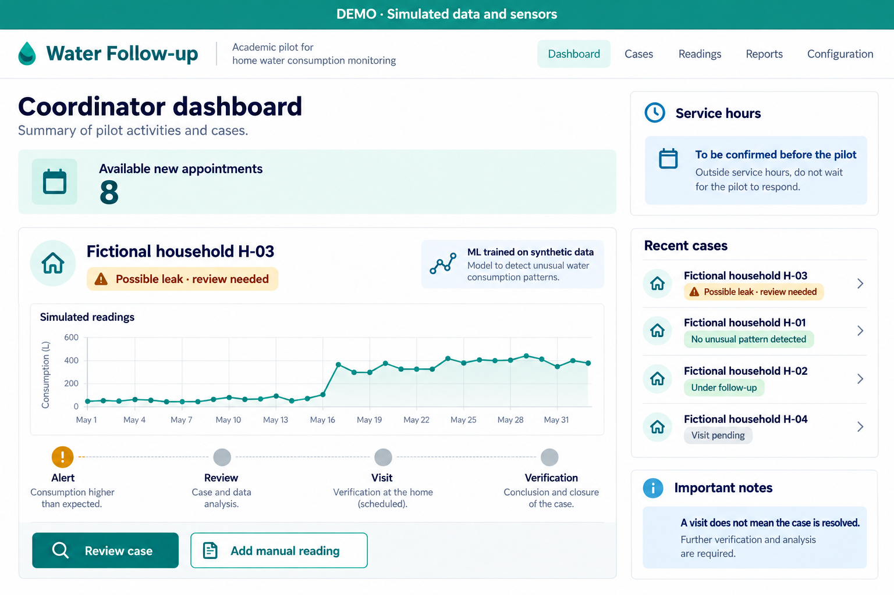
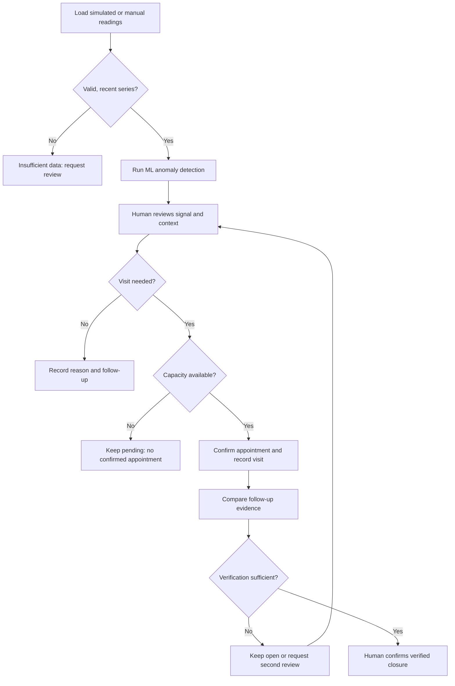
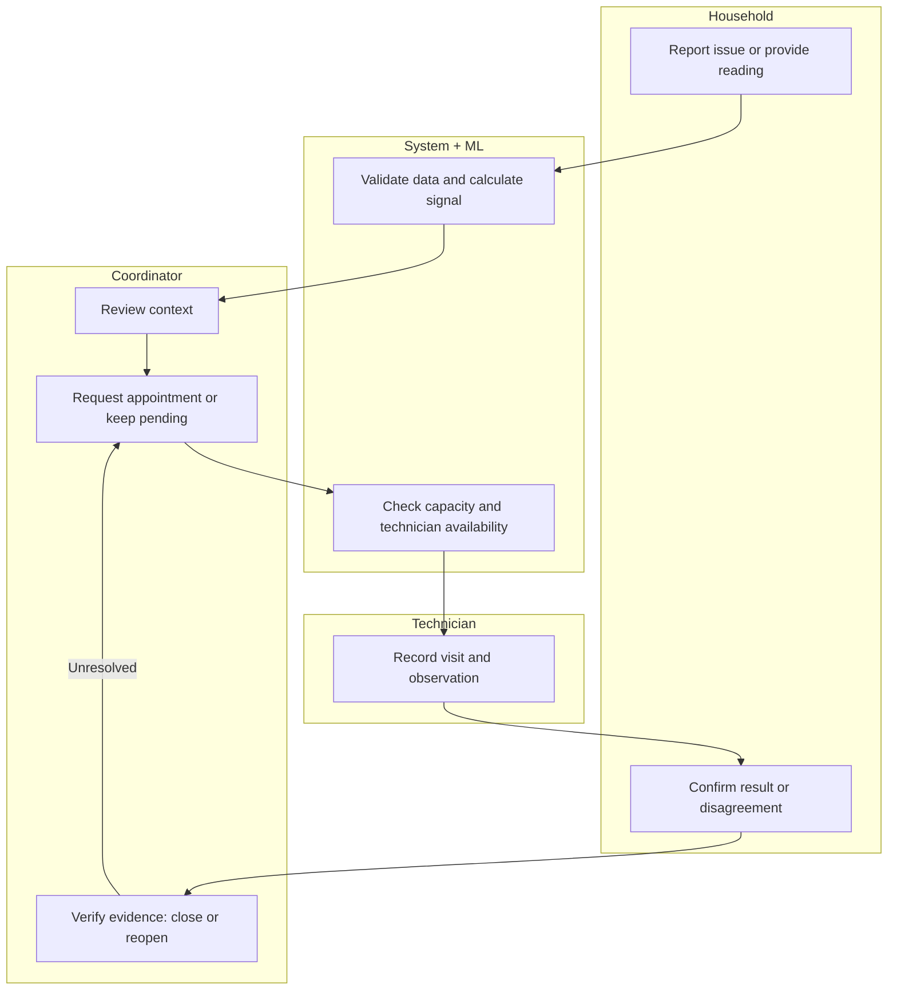

# PACKET · Week 11
## Water Follow-up
Isabella Zevada · Business Bending · October 19, 2026

PACKET · WEEK 11

Water Follow-up

Isabella Zevada · Business Bending · October 19, 2026

**Status: pre-code working draft.** The final team Blueprint has not been provided or recovered. The proposed vacuum, conditions and shadow clause must be checked against it. This packet does not claim completed tests, commits, deployments or real-world results.

## 1. Problem and proposed vacuum

A water-use alert does not guarantee that a household receives an inspection, a repair or confirmation that the problem has stopped. I want to make each case visible from the first signal to verified follow-up, so that a completed visit is never mistaken for a solved problem.

The single proposed vacuum is **Household water tools**: a practical tool for managing a possible household leak through verification. Reading visibility supports that process; it is not a second declared vacuum.

## 2. Exact user and task

The primary user is the coordinator of a small household-support pilot, who reviews alerts, allocates limited appointments and follows up with technicians. Secondary actors are a household providing readings or checking its case and a technician reporting a visit. For this week, one demonstrator walks through clearly labeled fictional roles; a role selector is not authentication.

The invented case is household H-03: unusual overnight consumption, review pending and eight new appointment slots available. No real names, phone numbers, addresses or precise locations are included. The synthetic test persona is a time-pressed coordinator with basic app skills who tends to interpret green as “resolved”; this is not a real interview.

## 3. Success before the module closes

The live URL will load three synthetic scenarios (normal pattern, possible leak and insufficient data), run a real ML model, support human review, allocate an appointment without exceeding eight slots, record a visit and keep the case open until verification. A ninth attempt must explain the limit without creating an appointment. Missing or stale readings must never produce a safety claim.

Verification requires a technical observation, a before/after comparison using equivalent time windows and fictional household confirmation. The software checks that evidence fields exist; a person decides whether closure is justified. If the issue persists or the household disagrees, the case reopens for another review. The demo verifies workflow, not real repair effectiveness.

## 4. AI-generated concept mockup

Concept image generated with AI, not a screenshot of implemented software. The panel separates the model signal, appointment capacity, visit and verification. The final operational interface is intended for Spanish-speaking users; this packet and its concept image are in English.

Prompt summary: an accessible white-and-teal coordinator dashboard, a persistent simulated-data banner, fictional household H-03, eight available appointments, possible-leak review, synthetic-data ML label, manual entry and a clear statement that a visit does not mean resolution.

Service hours and the external support route remain unconfirmed. Before any real pilot, coverage, availability and possible cost must be checked. The interface must not invent a contact or imply that emergency support is already connected.

## Benchmark line

The best existing solution I use as my household leak-detection benchmark is **Moen Flo Shutoff with FloSense**, because it combines in-line sensing, learned consumption patterns and alerts; this is a selected reference, not a proven global ranking.

My slice localizes the workflow for a Spanish-speaking household-support pilot by adding human review, limited-capacity appointment assignment, manual input and verified repair follow-up without purchasing sensors for this submission.

Moen documents learning from household use, unusual-activity alerts and controls for false alerts. This supports treating my model output as a signal requiring human review, not a diagnosis. I do not claim the benchmark lacks services that I have not investigated.

Source: Moen. (n.d.). <i>FloSense, explained.</i> Retrieved October 19, 2026. <link href="https://solutions.moen.com/Moen_Flo_Shutoff/Alerts,_Notifications,_and_Settings/FloSense,_explained">Official Moen documentation</link>

https://solutions.moen.com/Moen_Flo_Shutoff/Alerts,_Notifications,_and_Settings/FloSense,_explained

## 5. Feature flow

A model signal starts a review. It does not authorize closure, guarantee safety or create service capacity.

## 6. Responsibility swimlane

Each lane shows who owns an action. The coordinator retains responsibility for decisions; the system supports validation and allocation.

Appointment branches: if no visit is needed, record the reason; if capacity is unavailable, keep the case pending. An unresolved case returns to coordination. Role switching in the academic demo does not provide secure access control.

## 7. Three-year view · light charter

If this slice works, in three years the product could connect compatible sensors, manual readings and a local technician network to support cases from start to finish. Each household would retain access to case status, assisted alternatives and clear explanations of hours, costs and limits. Growth would depend on verified repairs, human capacity and sustainable funding, without selling household data or promising unavailable care.

## 8. Proposed operating conditions

These conditions reflect my OPERATOR responses and remain subject to the final Blueprint. A person reviews urgency and need without using digital ability as an eligibility filter. The ML signal does not decide access or trigger water shutoff; manual and assisted alternatives remain available.

The initial cap is eight new appointments in the demonstration batch, not eight total cases or a weekly service promise. Repeat visits also consume capacity and cannot be hidden to make growth look better. Before scaling, capacity must be adjusted using actual pilot times. If technical opinions conflict, the case stays open and another plumber can review it.

If funding is unavailable, the case remains pending funding or referral with follow-up; costs are not automatically transferred to the household. Actual service hours and external support coverage must be verified. Outside those hours, users must seek external help without waiting for the pilot. Automatic receipt and human review have separate records.

Before funding ends, participants receive advance notice and a clear agreement on equipment, open cases and the monitoring end date. The demo will show that provider coverage and hours are unconfirmed rather than inventing them.

## 9. Proposed shadow clause · not yet ratified

**No alert, automatic reply, visit or absence of data will be presented as effective assistance, safety or a verified repair.** A household can challenge closure and will not lose access for being unable to use an app. Household readings will not be used for behavioral surveillance, data sales, sanctions or automatic service shutoff.

## 10. Scope cut

Build only a follow-up demo with three scenarios, case states, ML inference, manual entry and capacity-based service assignment. Exclude physical sensors, automatic shutoff, payments, claimed monetary savings, real WhatsApp integration, a public technician directory, geographic routing, personal data, emergency operations, real notifications and multi-organization scaling. This is neither an awareness campaign nor a recycling-tips app.

## 11. Architecture and free stack

| Layer | Proposed choice | Evidence |

| --- | --- | --- |

| Interface | React + Vite + TypeScript | Three scenarios; mobile-accessible forms and states |

| IoT / sensing | Synthetic JSON feed; 15-minute intervals | Permanent simulation label; timestamps; L per interval |

| Real ML | Small logistic regression trained offline with Python/NumPy; JSON coefficients; TypeScript inference | Training script, seed, synthetic dataset, model version and evaluation |

| Third layer | Marketplace/service assignment logic with fictional technicians and schedules | Appointment needs capacity and an available technician; no duplicates |

| Demo state | Browser memory and reset button | No database, accounts or submitted inputs sent to a server |

| Publication | Free static hosting and GitHub repository | Live URL, source, at least five commits and two deployments |

Data path: feed or form → validation → feature extraction → ML inference → human review → assignment → case history → verification. The model uses overnight average consumption, variability and consecutive intervals with consumption. It learns coefficients from normal and anomalous synthetic patterns; fixed rules or scripted responses must not be labeled as ML.

Split training and evaluation by synthetic household, using a fixed seed and cases with legitimate high consumption, small leaks and intermittent supply. Do not duplicate windows across sets. Publish a confusion matrix, precision and recall without extrapolating to real households. The proposed technical target is precision and recall of at least 0.80 on the held-out synthetic set; if missed, document and revise before accepting the feature. The score is a demo signal, not confirmed leak probability. Insufficient data bypass inference.

## 12. Security floor by design

No API keys are required. Any future integration must keep secrets in server-side environment variables, outside the repository and browser bundle. The demo accepts only fictional codes, readings and closed choices, with no names, addresses or personal free text. It stores no personal data; the role selector is not authentication.

If scope changes to store personal data, implement Supabase Auth with Google and per-user Row Level Security before enabling collection. Hiding buttons is insufficient. Validate household codes H-01 to H-20, finite readings from 0 to 10,000 L per interval, non-future timestamps, at most 672 intervals per upload and catalog-based reasons. Reject negative values, NaN, duplicates and invalid schemas, with errors beside the field. A single manual reading cannot support temporal inference: require a sufficient series or leave the case pending. Label every demo household and technician as fictional.

## 13. Test plan · not yet executed

| Test case | Expected result |

| --- | --- |

| Normal / anomalous / incomplete feed | Appropriate signal; incomplete data never means safe |

| Negative, infinite or future reading | Rejected without changing valid state |

| Latest reading older than 24 hours | Stale-data state; no inference |

| Eight appointments, then a ninth attempt | Eight confirmed; ninth remains pending |

| Double click or occupied technician | No duplicate booking or overlapping technician slot |

| Visit without follow-up evidence | Verified closure blocked |

| Household disagrees / problem persists | Reopen and request a second review |

| No funding / pilot ends | Visible pending status and limits; no false closure |

| Report outside service hours | No immediate-response promise; receipt is not review |

| Reload and reset | Explain in-memory state loss; restore fictional scenarios |

**Mechanical pass:** run the cases, record expected versus observed results and screenshots, fix at least one genuinely discovered bug and publish a second deployment. If the first pass reveals no bug, extend edge cases rather than inventing a failure.

**Persona pass:** open a fresh chat with the fictional coordinator and show actual product screenshots in order. Ask her to review H-03, allocate an appointment, record a visit and attempt closure, narrating uncertainty and possible abandonment. Log every confusion, fix the worst one and repeat that section. Synthetic findings do not replace research with real people.

## 14. Implementation and evidence plan

**Commit 1:** packet, mockup and decisions before code. **Commit 2:** interface, synthetic feed and validation. **Commit 3:** reproducible training, inference and held-out evaluation. **Commit 4:** assignment, state transitions and evidence-based closure; deployment 1. **Commit 5 or later:** mechanical test, real bug fix, persona findings and changes; deployment 2. Tests should verify substantive rules, especially capacity and closure.

Every session closes by updating DECISIONS.md, noting tomorrow’s first move, committing and pushing. Keep commit hashes, both deployment links, test records and the full development conversation. Version packet changes without erasing the pre-code version. Submit the live URL, GitHub link, DEMO_IsabellaZevada.mp4 (3-minute walkthrough plus 30 seconds on what changed my mind), PACKET_IsabellaZevada.pdf, PERSONA_IsabellaZevada.pdf and BUILDCHAT_IsabellaZevada.pdf.

## 15. Items still requiring confirmation

Insert the final Blueprint and its exact shadow clause; confirm Household water tools as the single approved vacuum and service-assignment logic as the third Dragon Stack layer. No real provider or operational hours have been selected. This draft supports design review but does not establish full Blueprint compliance or readiness to operate with real households.